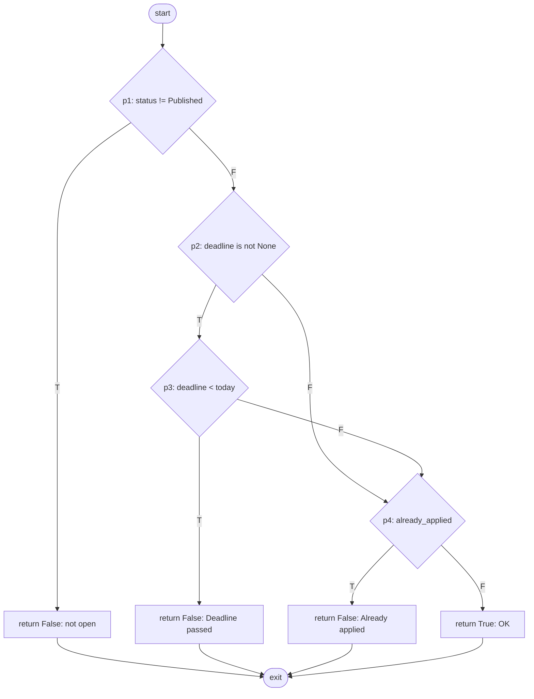

# Student Research Collaboration Platform: Technical Development Plan

Baseline: **SRS v1.2** (FR-001 to FR-038, NFR-001 to NFR-010, BR-001 to BR-006, sections 6.1 to 6.4, Appendices D to H). Where this plan and the SRS disagree, the SRS wins (SRS 1.1).
Team: 3 members (Member A, B, C). The runnable application entry point is `backend/main.py`; `docs/main.py` is a fuller starter prototype and is not the production entry point. The implementation is incremental: agree on interfaces first, then build three independently testable workstreams.

- Part I: end-to-end development plan (sections 0 to 14).
- Part II: Experiment, black-box + white-box testing and Selenium automation, written so **one member (Member C) can complete it alone**, with all the code.

---

# PART I: DEVELOPMENT PLAN

## 0. Ground rules

### 0.1 Stack (SRS 2.4, 5.4, 6.3)

| Layer | Choice | SRS basis |
|---|---|---|
| Client | Responsive web app, React + Vite (framework not fixed by SRS) | 3.1: tablet-usable, evergreen browsers |
| Backend | Python **FastAPI** REST service ("Java/Spring Boot **or equivalent**") | 2.4; OpenAPI is auto-generated, satisfying 5.4 Interoperability |
| Database | PostgreSQL (SQLite only for local dev/tests) | 2.4, 3.3 |
| File storage | Private volume/object store, referenced from DB, never public URLs | 3.3, NFR-008 |
| Agent | Separate Python service/container, internal authenticated API | 2.1, 3.3 |
| Deploy | Docker + docker-compose, CI/CD pipeline, secrets via env | 6.3 |
| VCS | Git with shared remote | 2.5, 6.4 |

### 0.2 Out of scope: do **not** build (SRS 1.4.1)
Payments/grants, cross-institution federation, native mobile apps, plagiarism detection, LMS/SIS integration, autonomous agent decisions.

### 0.3 Resolution of the TBD list (Appendix C)

| TBD | Decision |
|---|---|
| TBD-001 LLM framework | Deterministic, explainable scoring (required by FR-025/026). An LLM is optional and sits behind an interface `Explainer`; tests use a stub (2.5). |
| TBD-002 Hosting | docker-compose on one VM. |
| TBD-003 GitHub | **Not included** (optional, Low, risk R-05). Revisit only after all High/Medium items pass. |
| TBD-004 Notifications | In-app is mandatory (FR-022). SMTP email is optional, enabled by env, failure never blocks (4.6 alternate flow). |

### 0.4 Decisions not stated in the SRS (flagged, change by team vote)
1. `capacity` is an integer >= 1 (FR-006 says "maximum number of students"; 0 or negative is meaningless). Found by BVA, see Part II.
2. Allowed registration domains come from env `ALLOWED_DOMAINS` (default `ves.ac.in`); FR-001 only says "institutional".
3. Only Student/Faculty can self-register. Coordinator/Administrator are assigned by an administrator (FR-003 allows "administrative action").
4. Opportunity gets a `deadline` date column, needed by FR-035 ("nearing or past deadline") and 4.7.
5. `opportunity_versions` table to preserve requirements at application time (4.2 alternate flow, FR-007).
6. Minimum password length is 8 characters; the SRS only requires secure storage (NFR-005), so this is a design choice.

## 1. Architecture

```
 Browser (React SPA)  --HTTPS/JSON-->  Reverse proxy (TLS, rejects HTTP)
                                            |
                                    +-------v--------+   internal HTTP + X-Service-Token   +----------------+
                                    |  Backend API   |------------------------------------>|  Agent service |
                                    |  FastAPI       |<------------------------------------|  (Python)      |
                                    |  auth, RBAC,   |   ranked list + reasons / alerts    |  no DB access  |
                                    |  business rules|                                     +----------------+
                                    +---+--------+---+
                                        |        |
                                PostgreSQL    private file volume
```

Rules that implement FR-030 / BR-005 / SRS 5.2 architecturally:
- The **agent service has no database credentials**. The backend sends it a minimal JSON slice (NFR-009) and **the backend** persists the returned `AgentRecommendation` rows.
- No agent code path can write `applications.status` or `project_members` (enforced by a test, task C6).
- If the agent times out (10 s, NFR-002), the dashboard still renders and the panel shows "not available right now" (4.7 exception flow, 5.4 Reliability).

## 2. Repository layout (target)

```
backend/
  app/
    main.py config.py db.py models.py security.py deps.py rules.py
    routers/{auth,profiles,opportunities,applications,projects,resources,milestones,
             notifications,agent,dashboards,lor,admin}.py
    services/{notifier,activity,agent_client,storage}.py
    jobs/{reminders,agent_scan}.py
  alembic/
  tests/{unit,api}/
agent_service/{app,matching,progress,explainer}.py
agent_service/tests/
frontend/src/{pages,components,api,hooks}/
tests/ui/                   (Selenium, Part II)
docker-compose.yml  .github/workflows/ci.yml  .env.example  README.md  docs/
```
The current API scaffold is `backend/main.py`; the larger reference implementation is `docs/main.py`. Member A owns the first production module split and migration setup. Other members can start against the agreed API schemas and local fakes without waiting for that split to finish.

### 2.1 Independent workstreams and contract kit

The three members own separate vertical slices and directories. Shared behavior is agreed through a small contract kit, not by editing another member's implementation.

| Contract artifact | Contents | Owner / approval |
|---|---|---|
| API schema and OpenAPI | Routes, request/response fields, role requirements, status codes, stable error shape | Member A drafts; all three approve before the first integration milestone |
| Domain vocabulary | Role names, status enums, IDs, timestamps, nullable fields, relationship rules from section 3 | Member A drafts from the SRS; Members B and C review fields used by their slices |
| Fixtures and fakes | Example users/opportunities/applications/projects, fake notifier, fake agent responses, predictable errors | Each member owns fixtures for their slice; shared fixtures are versioned with the contract |
| Change record | Contract version, compatibility note, affected routes and consumers | Change author updates it; all three approve breaking changes |

Working rules:

1. Agree the minimum route and data contracts in the first two working days; do not wait for complete implementations.
2. Each member builds a fixture-backed or stubbed version of their slice so another member can integrate before external services are ready.
3. Keep changes additive where possible. A field rename, status semantic change, or route behavior change requires a contract version update and an integration test.
4. Integrate at the milestone gates in section 12. Between gates, each stream runs its own tests and contract tests.
5. Shared database models and app startup are coordinated by Member A. Members B and C own their routers/services and request changes to shared models through a reviewed PR rather than editing those files independently.

## 3. Data model (SRS 6.1, App. H), PostgreSQL

| Table | Columns (beyond PK) | Constraints / indexes |
|---|---|---|
| users | email, password_hash, name, role, status, verify_token, created_at | UNIQUE(email); CHECK role IN (Student, Faculty, Coordinator, Administrator); CHECK status IN (Pending Verification, Active, Disabled) |
| skills | name, category | UNIQUE(name) |
| student_profiles / faculty_profiles | user_id, research_experience or bio, updated_at | UNIQUE(user_id); link tables `student_skills`, `student_interests`, `faculty_expertise` |
| opportunities | faculty_id, title, description, domain, duration, capacity, status, deadline, published_at, requirements_version | CHECK capacity >= 1; CHECK status IN (Draft, Published, Closed, Archived); INDEX(status, published_at DESC) |
| opportunity_versions | opportunity_id, version, title, description, skills_json, created_at | UNIQUE(opportunity_id, version) |
| opp_skills | opp_id, skill_id | PK(both) |
| applications | student_id, opportunity_id, motivation, profile_snapshot, req_version, status, faculty_comment, submitted_at, decided_at | partial UNIQUE(student_id, opportunity_id) WHERE status <> 'Withdrawn'; CHECK status IN (Submitted, Shortlisted, Accepted, Rejected, Withdrawn) |
| projects | opportunity_id NULL, title, description, status, created_at | CHECK status IN (Active, Completed, On Hold) |
| project_members | project_id, user_id, role_in_project, joined_at | UNIQUE(project_id, user_id); CHECK role IN (Lead, Member) |
| milestones | project_id, description, target_date, status, completed_at | CHECK status IN (Not Started, In Progress, Completed, Blocked); INDEX(project_id, target_date) |
| tasks | milestone_id, description, status, assigned_to NULL | same status CHECK |
| resources | project_id, title, description, type, storage_reference, uploaded_by | CHECK type IN (Paper, Dataset, Link, File) |
| notifications | user_id, type, message, related, read, created_at | INDEX(user_id, read) |
| agent_recommendations | user_id, type, reference_entity, reason_text, score, status, created_at | UNIQUE(user_id, type, reference_entity) (dismissal not re-shown, FR-031) |
| activity_log | actor_user_id NULL, entity_type, entity_id, project_id NULL, action, timestamp | INDEX(project_id, timestamp DESC) |
| recommendation_letters | faculty_user_id, student_user_id, project_id NULL, status, requested_at, decided_at, body | CHECK status IN (Requested, Issued, Declined) |

All foreign keys enforced (SRS 6.1). Migrations by Alembic.

## 4. API contract (all JSON over HTTPS; OpenAPI at `/docs`)

Errors: `400` generic registration failure (no account enumeration, FR-002), `401` generic bad credentials, `403` role/membership, `404`, `409` state conflict (closed opportunity, duplicate, capacity), `422` validation. Every route except register, login, verify, and public opportunity search/detail requires a token (NFR-006); role checks run on the server (NFR-007).

| Section | Method + path | Roles | FR | Starter |
|---|---|---|---|---|
| 4.1 | POST `/auth/register`, POST `/auth/verify/{token}`, POST `/auth/login`, GET `/me` | public / any | FR-001, 002 | ✅ (email not sent) |
| 4.1 | PUT `/profile/student`, PUT `/profile/faculty`, GET `/skills` | Student / Faculty | FR-004, 005 | ✅ |
| 4.2 | POST `/opportunities`, PUT `/opportunities/{id}`, POST `/opportunities/{id}/state/{publish|close|archive}` | Faculty | FR-006, 007 | ✅ (versions to add) |
| 4.2 | GET `/opportunities?domain&skill&duration&available&q`, GET `/opportunities/{id}` | public | FR-008 | ✅ (add pagination) |
| 4.3 | POST `/opportunities/{id}/apply`, GET `/applications/mine`, POST `/applications/{id}/withdraw` | Student | FR-009, 010 | ✅ |
| 4.3 | GET `/opportunities/{id}/applications`, POST `/applications/{id}/decide` | Faculty | FR-011, 012 | ✅ |
| 4.3 | POST `/projects`, GET `/projects`, GET `/projects/{id}` | Faculty / members | FR-013, 014 | ✅ |
| 4.4 | POST/GET `/projects/{id}/resources`, DELETE `/resources/{id}` | members | FR-015 to 017 | ✅ links only |
| 4.4 | PUT `/resources/{id}`, POST `/projects/{id}/resources/upload`, GET `/resources/{id}/download` | members | FR-015 to 017, NFR-008 | to add |
| 4.5 | POST `/projects/{id}/milestones`, PATCH `/milestones/{id}`, POST `/milestones/{id}/tasks`, PATCH `/tasks/{id}`, GET `/projects/{id}/milestones/overdue` | lead / members | FR-018 to 020 | ✅ |
| 4.5 | GET `/projects/{id}/activity?page=` | members | FR-021 | to add |
| 4.6 | GET `/notifications`, POST `/notifications/{id}/read`, job `run_reminder_job` | any | FR-022 to 024 | ✅ (no scheduler/email) |
| 4.7 | GET `/agent/recommendations`, POST `/agent/recommendations/{id}/dismiss`, GET `/agent/projects/{id}/collaborators`, GET `/agent/projects/{id}/resources`, GET `/agent/alerts`, job `run_agent_scans` | Student / lead / Faculty | FR-025 to 031, 035 | ✅ (in-process) |
| 4.8 | GET `/dashboard/student`, `/dashboard/faculty`, `/dashboard/coordinator` | by role | FR-032 to 034 | ✅ |
| 4.9 | POST `/lor/issue`, POST `/lor/request`, GET `/lor/{id}/summary`, POST `/lor/{id}/decide`, GET `/lor/mine` | Faculty / Student | FR-036 to 038 | ✅ |
| Admin | GET `/admin/users`, PATCH `/admin/users/{id}`, GET `/admin/audit` | Administrator | 2.3, 6.2 | ✅ |

## 5. Agent service internal API (SRS 3.3, 4.7, NFR-009)

All calls: `POST http://agent:8100/internal/v1/...` with header `X-Service-Token: <env>`; backend timeout 10 s (NFR-002); only structured fields are sent (skills, interests, domain, timestamps, no names/emails/free text).

```json
// POST /internal/v1/match/opportunities
{ "student": {"skills": ["python","ml"], "interests": ["ai"]},
  "opportunities": [{"id": 7, "domain": "AI", "required_skills": ["python","ml","statistics"]}] }
// 200
{ "items": [{"opportunity_id": 7, "score": 25,
             "reason": "You have 2 of 3 required skills: ml, python; Matches your interest in AI"}] }
```
Other endpoints, same style: `/match/collaborators` (team skills + project requirements → candidate ids + "Fills skill gap: x"), `/match/resources`, `/progress/milestones` (id, target_date, status, last_activity_at → overdue/inactive alerts with a recommended action), `/progress/opportunities` (id, deadline, application_count, capacity → FR-035 alert naming one of: broaden required skills, extend deadline, promote).
Scoring (deterministic, explainable, FR-025/026): `score = 10*|shared skills| + 5*[domain in interests] + 3*|required ∩ interests|`; reason text lists the concrete factors. Dismissed items are never re-created (UNIQUE key, FR-031).

## 6. Frontend plan (SRS 3.1, 3.1.1)

| Screen | Roles | FR | Notes |
|---|---|---|---|
| Login / Register | all | 001, 002 | inline validation, generic errors, separate new/returning actions |
| Student dashboard | Student | 032 | recommendations panel loads **independently** (NFR-002, 3.1.1) |
| Faculty dashboard | Faculty | 033 | pending applicants, projects, overdue count, agent alerts |
| Opportunity list + filters | all | 008 | filters update via fetch, no page reload (NFR-004) |
| Opportunity detail + apply | Student | 009, 010 | shows status if applied |
| Applicant review | Faculty | 011 | shortlist / accept / reject + comment |
| Project workspace | members | 014, 015 to 021 | members, milestones, tasks, resources, activity feed |
| Agent panel | Student/Faculty | 026, 031 | visually distinct (advisory), reason + dismiss |
| Admin / Coordinator | Admin/Coord | 034, 2.3 | user/role mgmt, aggregates |
| LOR | Faculty/Student | 036 to 038 | request, summary, issue/decline |

Every screen implements the four states: loading, empty, error/unavailable, access-denied (visually distinct from empty). Accessibility: contrast, keyboard navigation, labels, tablet-width layout. **Testability convention:** every interactive element has `data-testid="<screen>-<element>"` so the Selenium suite (Part II) does not depend on CSS.

## 7. Work packages (three independently testable members)

Each work package has a named owner, explicit prerequisites, and a measurable completion check. Refine sizing after the contract-kit milestone. A member may use fixtures or fakes for unmet dependencies, but must replace them with contract tests at integration.

### Member A: Identity, opportunities, applications, and platform foundation

Owns `backend/app` foundation, auth/profile/opportunity/application/admin routes, corresponding backend tests, auth/opportunity frontend screens, migrations, and deployment/CI configuration.

| ID | Work package | Needs | Done when |
|---|---|---|---|
| A1 | Confirm contract kit; split the current API entry point into config, DB, models, security, dependencies, rules, and routers; set up migrations and seed data | None; contract-kit review | App starts from the documented command; migration can create a clean local DB; existing health behavior remains tested |
| A2 | Registration, verification, login, password hashing, token handling, profile CRUD, and self-registration role restrictions | A1, contract kit | Functional tests cover valid/invalid registration, verification, generic duplicate errors, login, profiles, and role checks; no production verification token is returned |
| A3 | Server-side permission matrix and admin user management | A2 | Each protected route is tested for unauthenticated access and relevant roles; denied requests cannot mutate data |
| A4 | Opportunity create/edit/publish/close/archive/search/detail, capacity validation, deadlines, versions, pagination | A1, contract kit | Lifecycle and filters pass API tests; archived items are excluded from default discovery; edits preserve application-time requirement versions |
| A5 | Apply, withdraw, list/review applications, faculty decisions, capacity and timestamps | A2, A4 | Duplicate and closed/expired applications are rejected; withdrawal frees a place; only owning faculty can decide; acceptance cannot exceed capacity |
| A6 | Team creation and membership-facing project endpoints; administrator/coordinator functions | A5, Member B contract | Accepted applications create expected members; membership checks are covered; admin/coordinator access matches the role matrix |
| A7 | Auth, profile, opportunity discovery/detail/apply, applicant review and admin UI | A2-A6 API contracts | UI handles loading, empty, error, and denied states; controls are keyboard usable and carry `data-testid` attributes |
| A8 | Docker/compose, environment example, CI, OpenAPI publication, deployment notes and TLS proxy configuration | A1; other streams provide runnable health checks | Clean compose startup, health checks, tests, and image build pass; secrets are external to source control |

### Member B: Project workspace, resources, milestones, notifications, and LOR

Owns project workspace routes/services/tests and their UI. Uses Member A's user/project/application models and the contract kit; does not change shared models without review.

| ID | Work package | Needs | Done when |
|---|---|---|---|
| B1 | Resource metadata API and private storage adapter, size/type limits, update/delete, membership-checked upload/download | Contract kit, storage interface; fake storage may be used first | Unauthorized users cannot upload, list, update, delete, or download; files are not served from public/guessable URLs |
| B2 | Milestones, tasks, status transitions, assignment and lead/faculty permissions | Project/member contract | Valid and invalid state changes are tested; non-members cannot read or mutate project work |
| B3 | Shared overdue calculation and project activity feed with pagination | B2, activity-log contract | Dashboard and scheduled checks use the same overdue rule; feed is ordered and paginated, with membership enforcement |
| B4 | Central activity logging for membership, resources, milestones, application and recommendation events | Contract kit; coordinate event names with A and C | Required changes create attributable, queryable activity records; tests verify actor, entity, project, action and time |
| B5 | In-app notifications and reminders; optional SMTP adapter; scheduled worker with status re-check | Contract kit; notifier fake | In-app delivery works without SMTP; mail failure does not block requests; reminder job rechecks eligibility before sending |
| B6 | Recommendation-letter issue/request/summary/decision workflow | A2, B4, notification service | Shared-history rule, duplicate pending request, performance summary, decisions, and notifications have API tests |
| B7 | Project workspace, resources, milestones/tasks, activity, notification and LOR UI | B1-B6 contracts; fake responses until APIs are ready | Responsive UI covers loading, empty, failure and denied states; user-visible status and accessible controls are tested |

### Member C: Agent service, dashboards, safety, and quality

Owns `agent_service/`, backend agent client/dashboard routes, agent/dashboard UI, cross-stream acceptance testing and the final verification guide.

| ID | Work package | Needs | Done when |
|---|---|---|---|
| C1 | Internal agent API, service-token validation, request/response schemas, deterministic fake implementation | Contract kit | Requests without the service token fail; schema and timeout behavior have tests; service has no database driver or DB credentials |
| C2 | Deterministic matching, concrete explanations, collaborator/resource suggestions | C1; A's skill/opportunity contracts; B's resource contract | Fixture tests verify scores, rankings, tie breaks and reason text; only platform-indexed/authorized data is considered |
| C3 | Milestone inactivity/overdue and opportunity deadline/capacity alerts | C1; B's milestone contract; A's opportunity contract | Boundary tests cover due dates, completed milestones and deadline windows; alerts state advisory actions |
| C4 | Backend agent client, data minimization, 10-second timeout, fail-safe unavailable response, backend-owned persistence and dismissal | C1-C3 | Agent failure does not break dashboards; only minimal structured data is sent; scans cannot mutate application status or memberships |
| C5 | Student/faculty/coordinator dashboards and advisory agent panels | A and B API contracts; fake responses for parallel UI work | Role-specific payloads and four UI states are tested; recommendation panel failure is isolated from the rest of the dashboard |
| C6 | Safety and acceptance suite, basis-path and EP/BVA tests, Selenium tests, performance checks | Stable contracts; A/B/C endpoints available at integration | Agent safety invariant is verified; all acceptance scenarios are traceable; performance is measured at 100 concurrent users against NFR-001/003 |
| C7 | Setup/run/test documentation and final requirements traceability review | A8 and all stream test results | A new contributor can run the app and tests from README instructions; every FR has an implementation owner and passing verification or a documented gap |

### Cross-stream handoffs

| Producer | Consumer | Frozen handoff |
|---|---|---|
| A | B | User IDs/roles, accepted application IDs, project creation payload, project-member roles, auth dependency |
| A | C | Student skills/interests, opportunity skills/domain/deadline/capacity, application and project identifiers |
| B | C | Milestone status/target/activity timestamps, resource metadata and visibility rules, activity events |
| C | A and B | Agent request/response schemas, timeout/unavailable behavior, recommendation IDs/reasons/status; agent has no write path to academic decisions |

## 8. Schedule and integration milestones

The schedule is a four-week target, not a promise that work must be serial. All streams begin with fixtures and contracts, then integrate only against the milestone gates below.

| Milestone | Member A | Member B | Member C | Exit gate |
|---|---|---|---|---|
| M0 — Contract kit (first 2 days) | Draft API/data contracts; scaffold backend modules and migration path | Review project/resource/milestone/notification fields; define storage/notifier interfaces | Review agent/dashboard payloads; provide fake agent schema and test fixtures | Versioned contracts, initial OpenAPI, shared status/role enums, representative fixtures, local test commands agreed |
| M1 — Foundation (week 1) | Auth, profiles, role checks, DB/migrations, CI baseline | Storage/notifier interfaces and project workspace skeleton against fakes | Agent skeleton/token auth, pure scoring/rule tests, test harness | API health and auth work; all three streams run isolated tests; no downstream stream blocked on live integrations |
| M2 — Core workflows (week 2) | Opportunity lifecycle and applications; first auth/opportunity UI | Resources, milestones/tasks, project activity and notifications | Matching/progress rules, agent client, student dashboard | Apply → faculty decision → project → milestone flow works in integration; agent remains advisory and can fail independently |
| M3 — Complete feature slices (week 3) | Team creation, admin/coordinator, applicant review UI | LOR workflow, reminders, project/notification/LOR UI | Dashboards, recommendations and alert panel, safety tests | Functional coverage across FR-001..038 with known gaps explicitly recorded; role and membership checks pass |
| M4 — Release hardening (week 4) | Compose/deploy, OpenAPI, security fixes, migration verification | Bug fixes, user guides, notification/storage checks | Acceptance/Selenium/performance tests, traceability report | CI and acceptance suite pass; private-file and agent-safety checks pass; README supports a clean setup |

## 9. Cross-cutting requirements

| Requirement | How it is met |
|---|---|
| NFR-001 (2 s) | indexes in section 3, pagination, load test C7 |
| NFR-002 (10 s agent) | timeout + loading skeleton + independent panel |
| NFR-003 (100 users) | uvicorn workers, DB pool, Locust run |
| NFR-004 | filters via fetch, debounced |
| NFR-005 | salted PBKDF2 (starter) or Argon2; never plaintext |
| NFR-006, 007 | token on every protected route; `require(role)`; matrix test A3 |
| NFR-008 | no public file URLs; download streams through the API after membership check |
| NFR-009 | agent payload limited to skills, interests, domain, timestamps |
| NFR-010 | pydantic validation + `nh3` HTML sanitising on every text field (starter has minimal escaping only) |
| 6.2 logging | `log()` for auth, application status, membership, milestones, agent recs |
| 6.3 deployment | Docker, CI/CD, secrets outside code, `.env.example` |
| 6.4 maintenance | issues reference FR ids; agent changes re-run FR-030 safety test |
| 3.4 | HTTPS only at the proxy; internal agent API not published to host |

## 10. Traceability (FR to owner to verification, per SRS 1.2)

| FR | Owner | Verification | FR | Owner | Verification |
|---|---|---|---|---|---|
| 001 | A | Functional | 020 | B | Functional |
| 002 | A | Functional/security | 021 | B | Functional |
| 003 | A | Security | 022 | B | Functional |
| 004 | A | Functional | 023 | B | Functional |
| 005 | A | Functional | 024 | B | Functional |
| 006 | A | Functional | 025 | C | Agent evaluation |
| 007 | A | Functional | 026 | C | Agent evaluation |
| 008 | A | Functional | 027 | C | Agent evaluation |
| 009 | A | Negative | 028 | C | Agent evaluation |
| 010 | A | Functional | 029 | C | Scenario |
| 011 | A | Functional | 030 | C | Safety/permission |
| 012 | A | DB/functional | 031 | C | Functional |
| 013 | A | Functional | 032 | C | UI |
| 014 | A | Access-control | 033 | C | UI |
| 015 | B | Functional | 034 | C | Functional |
| 016 | B | Security | 035 | C | Agent evaluation |
| 017 | B | Functional | 036 | B | Functional |
| 018 | B | Functional | 037 | B | Functional |
| 019 | B | Functional | 038 | B | Functional |

All 38 requirements are covered. Business rules: BR-001 (A5), BR-002 (A6, `rules.py`), BR-003 (A6 + C6), BR-004 (B1), BR-005 (C6), BR-006 (A7, no hard limit).

## 11. Working agreements
- Branch per work-package ID (for example `a4-opportunity-lifecycle`); keep PRs scoped to the owning stream and cite relevant FR IDs.
- Every PR has a reviewer from a different stream when it changes a shared contract, authorization boundary, or integration surface.
- CI must run the backend unit/API tests, contract tests, Part II experiment tests, and configured linters; Selenium against third-party demo sites is an explicitly separate/manual job.
- Defects reference FR IDs and include a reproducible test or acceptance case.
- Contract changes update OpenAPI/fixtures and the change record in the same PR.
- Any agent-related PR is reviewed against FR-030/BR-005 and reruns the agent safety invariant.

## 12. Milestone integration checks

Integration happens at M0-M4 rather than by merging unfinished work continuously.

| Gate | Required checks |
|---|---|
| M0 contract gate | OpenAPI parses; role/status names and error schema are consistent; example requests/responses validate; each stream has a runnable fake or fixture |
| M1 foundation gate | Clean local database migration; health endpoint; registration/login/role tests; CI runs the same commands documented in README |
| M2 workflow gate | Published opportunity can be found and applied to; faculty decision creates valid accepted state; project membership controls access; milestone changes are logged |
| M3 feature gate | All member endpoints use shared auth and schemas; in-app notification, LOR, dashboard, agent failure, and dismissal paths pass integration tests |
| M4 release gate | Acceptance and safety suites pass; private downloads are membership-checked per request; no agent writes academic decisions; deployment configuration has no committed secrets |

For any failing gate, record the failing FR, owner, reproducer, and next decision. Do not mark a requirement complete based only on a stub or UI mock.

## 13. Acceptance checklist

- [ ] All FR-001 to FR-038 have an owner, API/UI implementation status, and test evidence in section 10.
- [ ] Every protected route enforces authentication, server-side role checks, and project membership where required.
- [ ] Opportunity and application rules pass boundary and state-transition tests, including capacity and deadline edges.
- [ ] Private resources are stored outside public web roots and authorization is checked for each read/download.
- [ ] Agent service has no database access; agent timeouts are bounded; recommendations cannot change applications or project membership.
- [ ] Every screen has loading, empty, error/unavailable, and access-denied states.
- [ ] Search/filter UI does not reload the page; tablet-width and keyboard-access checks are completed.
- [ ] CI, migrations, Docker Compose, API docs, and clean setup instructions work from a fresh checkout.
- [ ] NFR-001 and NFR-003 are verified with recorded measurements rather than assumed from configuration.

## 14. Risks and open decisions

| Risk / decision | Impact | Mitigation / owner |
|---|---|---|
| Current runnable backend is only a health-check scaffold while the fuller prototype is in `docs/` | Duplicated or inconsistent behavior | Member A identifies reusable logic, ports it into tested backend modules, and does not treat the docs prototype as production code |
| Three streams need common user/project/status fields | Integration rework | Freeze minimum API schemas and fixtures at M0; add contract tests for every consumer |
| PostgreSQL, migrations, mail, storage and agent provider increase setup burden | Contributors cannot run feature tests locally | Keep SQLite/test fakes available for unit/API tests; production-like Compose profile verifies PostgreSQL and service wiring |
| External email, file, or agent service is unavailable | Main workflows become unreliable | In-app notifications are mandatory; isolate email failures; provide deterministic agent/storage fakes and explicit unavailable states |
| Resource suggestions can expose another project's private data | Privacy/access-control failure | Only return resources visible to the requesting user or explicitly public; test cross-project access denial |
| Time is insufficient for the entire SRS | Partial feature delivery | Prioritize auth/RBAC, opportunity/application workflow, project membership/resources, and agent safety before optional email and visual polish; report incomplete FRs honestly |
| Domain policy, hosting details and optional integrations are undecided | Rework or accidental scope growth | Keep the decisions in section 0.3/0.4; change them by team agreement and update tests/documentation |

---

# PART II: EXPERIMENT (Member C)

## Aim
Perform black-box (equivalence partitioning / boundary value analysis) and white-box (basis path) testing and automate test cases using Selenium.

## Problem statement
The Student Research Collaboration Platform accepts user input at several points (registration, opportunity creation, application submission, milestone updates) and enforces business rules that decide what is allowed (a student may apply only to a published, not-expired opportunity, only once). Defects in input validation or in these rules would let invalid accounts register, let students apply to closed opportunities (violating BR-002/FR-009), or silently accept meaningless data such as an opportunity with capacity 0. The problem is to design a systematic, repeatable set of test cases that (1) derives inputs for the user-facing fields from the SRS using equivalence partitioning and boundary value analysis, (2) derives the minimum number of tests that exercise every independent path through one decision-heavy function using basis path testing, and (3) automates the user-interface tests with Selenium WebDriver (and records manual steps with Selenium IDE / TestCase Studio), so the same suite can be re-run after every change.

## Theory

### 1. Software testing
Software testing is the process of executing a program (or inspecting its artefacts) with the intent of finding defects and checking that it meets its specified requirements. It answers two questions: *are we building the product right* (verification) and *are we building the right product* (validation). Levels: unit, integration, system, acceptance. Approaches: black-box (behaviour from requirements), white-box (internal structure), and grey-box. Key principles: testing shows the presence, not the absence, of defects; exhaustive testing is impossible so inputs are chosen by technique; test early; defects cluster; the same tests lose power over time, so they are automated and regularly reviewed. Regression testing re-runs earlier tests after a change.

### 2. Working of Selenium (short)
Selenium is a suite: **Selenium IDE** (record and playback in the browser), **WebDriver** (programmatic control, used here), and **Grid** (parallel/remote runs). With WebDriver, the test script uses a language binding (Python `selenium`). Each command (open URL, find element, click, type) is sent as an HTTP request following the W3C WebDriver protocol to a **browser driver** (chromedriver / msedgedriver), which translates it into native browser actions and returns the result as an HTTP/JSON response. Elements are found with locators (id, name, CSS selector, XPath); **explicit waits** pause until a condition (visible, clickable, URL contains) holds, which removes timing flakiness. Selenium 4.6+ includes *Selenium Manager*, which downloads the matching driver automatically.

### 3. Black-box testing and its types
Black-box testing checks what the software does without looking at its code; test cases come from the requirements/specification. Types and techniques:
- **Functional testing**: verifies features against requirements (login, apply, approve).
- **Equivalence partitioning (EP)**: split inputs into classes that the system should treat alike and test one value per class.
- **Boundary value analysis (BVA)**: test at and around the edges of classes (min-1, min, min+1, max-1, max, max+1), where defects concentrate.
- **Decision table / cause-effect testing**: combinations of conditions and the resulting actions.
- **State transition testing**: valid and invalid status changes (for example Application: Submitted to Shortlisted to Accepted; Withdrawn cannot become Accepted).
- **Error guessing** and **use-case/scenario testing**.
- **Non-functional black-box tests**: usability, performance (NFR-001/003), security (access-denied checks), compatibility.
- **Regression testing**: re-running the above after changes.

### 4. Basis path testing (white-box) with an example
Basis path testing (McCabe) derives test cases from the control-flow graph (CFG) of a unit so that every statement and branch executes at least once. Steps: (1) draw the CFG; (2) compute cyclomatic complexity `V(G) = E - N + 2 = P + 1` (P = number of predicate nodes; compound conditions count each condition); (3) choose `V(G)` linearly independent paths, each adding at least one new edge; (4) write a test input and expected result for each path.

**Example, `check_application_eligibility` (FR-009/BR-002):** predicates p1 (status is not Published), p2 (deadline exists), p3 (deadline < today), p4 (already applied), so P = 4 and V(G) = 5. The five basis paths and their tests are in the table below.

## Implementation

### Setup
```bash
cd srcp
pip install -r requirements.txt pytest pytest-cov selenium
# Chrome or Edge must be installed for Selenium; Selenium Manager fetches the driver
```

### A. White-box testing: basis path on one functionality (application eligibility)

Unit under test (`rules.py`, used by `POST /opportunities/{id}/apply`):

```python
"""Pure business rules (no DB / no HTTP) so they can be white-box tested in isolation."""
import datetime as dt
from typing import Optional, Tuple


def check_application_eligibility(opp_status: str, deadline: Optional[dt.date],
                                  today: dt.date, already_applied: bool) -> Tuple[bool, str]:
    """FR-009 / BR-002: a student may apply only to a Published opportunity whose
    deadline (if any) has not passed, and only once (Withdrawn applications are ignored
    by the caller).  Returns (allowed, reason)."""
    if opp_status != "Published":                      # decision p1
        return False, "Opportunity is not open"
    if deadline is not None and deadline < today:      # decisions p2 and p3 (compound condition)
        return False, "Deadline passed"
    if already_applied:                                # decision p4
        return False, "Already applied"
    return True, "OK"
```

Control-flow graph (all returns join one exit node, so N = 10, E = 13, V(G) = 13 - 10 + 2 = **5**):



Basis set and test cases (today = 2026-10-22):

| ID | Path (predicate outcomes) | Input (status, deadline, already_applied) | Expected |
|---|---|---|---|
| BP1 | p1=T | Draft, 2026-10-27, False | (False, "Opportunity is not open") |
| BP2 | p1=F, p2=F, p4=T | Published, None, True | (False, "Already applied") |
| BP3 | p1=F, p2=F, p4=F | Published, None, False | (True, "OK") |
| BP4 | p1=F, p2=T, p3=T | Published, 2026-10-21, False | (False, "Deadline passed") |
| BP5 | p1=F, p2=T, p3=F, p4=F | Published, 2026-10-27, False | (True, "OK") |
| BP6 (extra) | p1=F, p2=T, p3=F, p4=T | Published, 2026-10-27, True | (False, "Already applied"); equals BP5 + BP2 - BP3, so it is not independent but is tested anyway |

Each of BP1 to BP5 introduces a new edge (p1=T; p1=F and p2=F and p4=T; p4=F; p2=T and p3=T; p3=F), which shows independence. Extra boundary checks: deadline equal to today is still open; deadline yesterday is closed.

Test code (`experiment/test_whitebox_basis_path.py`):

```python
"""
WHITE-BOX TESTING - Basis Path Testing
Unit under test: rules.check_application_eligibility()   (SRS FR-009, BR-002, FR-010)

Control-flow graph (nodes = numbered statements, predicates p1..p4):
  1 start
  2 p1: opp_status != "Published"          T -> 3 return (False,"not open")
  4 p2: deadline is not None               F -> 7
  5 p3: deadline < today                   T -> 6 return (False,"Deadline passed")
  7 p4: already_applied                    T -> 8 return (False,"Already applied")
  9 return (True,"OK")

Cyclomatic complexity  V(G) = P + 1 = 4 + 1 = 5   (= E - N + 2)
=> 5 linearly independent paths must be executed (basis set).
A 6th path (BP6) exists; it is a linear combination BP5 + BP2 - BP3 and is tested as an extra.
Run:  pytest -v test_whitebox_basis_path.py --cov=rules --cov-branch --cov-report=term-missing
"""
import sys, os, datetime as dt
sys.path.insert(0, os.path.join(os.path.dirname(__file__), ".."))
import pytest
from rules import check_application_eligibility as f

TODAY = dt.date(2026, 10, 22)
FUT, PAST = TODAY + dt.timedelta(days=5), TODAY - dt.timedelta(days=1)

# id, path (predicate outcomes), inputs (status, deadline, already), expected
CASES = [
    ("BP1", "p1=T",                 ("Draft",     FUT,  False), (False, "Opportunity is not open")),
    ("BP2", "p1=F,p2=F,p4=T",       ("Published", None, True),  (False, "Already applied")),
    ("BP3", "p1=F,p2=F,p4=F",       ("Published", None, False), (True,  "OK")),
    ("BP4", "p1=F,p2=T,p3=T",       ("Published", PAST, False), (False, "Deadline passed")),
    ("BP5", "p1=F,p2=T,p3=F,p4=F",  ("Published", FUT,  False), (True,  "OK")),
    ("BP6 (extra)", "p1=F,p2=T,p3=F,p4=T", ("Published", FUT, True), (False, "Already applied")),
]

@pytest.mark.parametrize("tc_id,path,args,expected", CASES, ids=[c[0] for c in CASES])
def test_basis_paths(tc_id, path, args, expected):
    status, deadline, already = args
    assert f(status, deadline, TODAY, already) == expected

@pytest.mark.parametrize("status", ["Closed", "Archived", "Draft", ""])
def test_every_non_published_status_rejected(status):                 # p1 true-branch variants
    assert f(status, None, TODAY, False)[0] is False

def test_deadline_boundary_today_is_still_open():                     # BVA on p3: deadline == today
    assert f("Published", TODAY, TODAY, False) == (True, "OK")

def test_deadline_boundary_yesterday_is_closed():
    assert f("Published", TODAY - dt.timedelta(days=1), TODAY, False) == (False, "Deadline passed")
```

Run and measure coverage:
```bash
cd srcp/experiment
pytest -v test_whitebox_basis_path.py --cov=rules --cov-branch --cov-report=term-missing
```
Recorded result in this workspace: **12 passed, 100% statement and 100% branch coverage** of `rules.py`.

### B. Black-box testing: EP and BVA

Test design (derived only from the SRS, no code knowledge):

| Field (SRS ref) | Valid partition | Invalid partitions | Boundary values tested |
|---|---|---|---|
| Password length (FR-001, min 8 assumed from design) | 8 or more characters | fewer than 8 | 0, 7 (reject); 8, 9 (accept); 64 (accept) |
| Email (FR-001 institutional) | institutional domain, any letter case | other domain, no "@", empty, look-alike `ves.ac.in.evil.com` | one value per class |
| Role at registration (FR-003) | Student, Faculty | Administrator, Coordinator, unknown | one per class |
| Opportunity capacity (FR-006) | integer >= 1 | 0, negative | -1, 0 (reject); 1, 2 (accept); 100 |
| Milestone target date vs today (FR-020) | not overdue: today, tomorrow | overdue: yesterday | -1 day (overdue), 0 (not), +1 (not) |
| Milestone status (FR-019) | Not Started, In Progress, Completed, Blocked | "Done", empty | one per value/class |

Automated at API level (`experiment/test_blackbox_ep_bva.py`, 31 test cases), run with `pytest -v test_blackbox_ep_bva.py`:

```python
"""
BLACK-BOX TESTING - Equivalence Partitioning (EP) + Boundary Value Analysis (BVA)
Target: the platform REST API (no knowledge of the code, only the SRS rules).
Run:  pytest -v test_blackbox_ep_bva.py
"""
import os, sys, datetime as dt
os.environ["DATABASE_URL"] = "sqlite:///./bb_test.db"
if os.path.exists("bb_test.db"): os.remove("bb_test.db")
sys.path.insert(0, os.path.join(os.path.dirname(__file__), ".."))
import pytest
from fastapi.testclient import TestClient
import main

c = TestClient(main.app)
_n = {"i": 0}
def reg(email=None, password="Password123", role="Student", name="T"):
    _n["i"] += 1
    return c.post("/auth/register", json={"email": email if email is not None else f"u{_n['i']}@ves.ac.in", "password": password, "name": name, "role": role})
def login_hdr(role):
    r = reg(role=role); c.post(f"/auth/verify/{r.json()['dev_verify_token']}")
    email = main.SessionLocal().query(main.User).order_by(main.User.id.desc()).first().email
    return {"Authorization": "Bearer " + c.post("/auth/login", json={"email": email, "password": "Password123"}).json()["token"]}

# ---- 1. Password length (FR-001, min 8).  Partitions: <8 invalid | >=8 valid.  BVA: 0,7,8,9
@pytest.mark.parametrize("pw,code", [("", 422), ("a" * 7, 422), ("a" * 8, 201), ("a" * 9, 201), ("a" * 64, 201)],
                         ids=["len0-invalid", "len7-below-boundary", "len8-boundary", "len9-above-boundary", "len64-valid-large"])
def test_password_length(pw, code): assert reg(password=pw).status_code == code

# ---- 2. Email (FR-001 institutional domain).  Partitions: valid domain | other domain | malformed | empty
@pytest.mark.parametrize("email,code", [("ok1@ves.ac.in", 201), ("OK2@VES.AC.IN", 201), ("x@gmail.com", 400), ("no-at-sign", 400), ("", 400), ("a@ves.ac.in.evil.com", 400)],
                         ids=["valid", "valid-uppercase", "other-domain", "malformed", "empty", "lookalike-domain"])
def test_email_partitions(email, code): assert reg(email=email).status_code == code

def test_duplicate_registration_is_generic_error():                   # FR-002 / no account enumeration
    reg(email="dup@ves.ac.in"); r = reg(email="dup@ves.ac.in")
    assert r.status_code == 400 and r.json()["detail"] == "Registration failed"

# ---- 3. Role at registration.  Partitions: Student/Faculty valid | Admin/Coordinator/garbage invalid (cannot self-assign)
@pytest.mark.parametrize("role,code", [("Student", 201), ("Faculty", 201), ("Administrator", 400), ("Coordinator", 400), ("root", 400)])
def test_role_partitions(role, code): assert reg(role=role).status_code == code

# ---- 4. Opportunity capacity (FR-006, positive integer).  BVA: -1,0,1,2
FAC = None
def _fac():
    global FAC; FAC = FAC or login_hdr("Faculty"); return FAC
@pytest.mark.parametrize("cap,code", [(-1, 422), (0, 422), (1, 201), (2, 201), (100, 201)], ids=["-1", "0-below-boundary", "1-boundary", "2", "100"])
def test_capacity_bva(cap, code):
    r = c.post("/opportunities", json={"title": "t", "description": "d", "domain": "AI", "capacity": cap}, headers=_fac()); assert r.status_code == code

# ---- 5. Milestone overdue boundary (FR-020).  target = today-1 (overdue) | today | today+1  (not overdue)
@pytest.mark.parametrize("delta,overdue", [(-1, True), (0, False), (1, False)], ids=["yesterday", "today", "tomorrow"])
def test_overdue_boundary(delta, overdue):
    f, s = _fac(), login_hdr("Student")
    sid = main.SessionLocal().query(main.User).order_by(main.User.id.desc()).first().id
    o = c.post("/opportunities", json={"title": "t", "description": "d", "domain": "AI", "capacity": 2}, headers=f).json()
    c.post(f"/opportunities/{o['id']}/state/publish", headers=f)
    a = c.post(f"/opportunities/{o['id']}/apply", json={"motivation": "m"}, headers=s).json()
    c.post(f"/applications/{a['id']}/decide", json={"status": "Accepted"}, headers=f)
    pid = c.post("/projects", json={"title": "p", "application_ids": [a["id"]]}, headers=f).json()["project_id"]
    c.post(f"/projects/{pid}/milestones", json={"description": "m", "target_date": str(dt.date.today() + dt.timedelta(days=delta))}, headers=f)
    assert (len(c.get(f"/projects/{pid}/milestones/overdue", headers=s).json()) == 1) is overdue

# ---- 6. Milestone status (FR-019).  Partitions: 4 valid values | anything else invalid
@pytest.mark.parametrize("status,code", [("Not Started", 200), ("In Progress", 200), ("Completed", 200), ("Blocked", 200), ("Done", 400), ("", 400)])
def test_milestone_status_partitions(status, code):
    f, s = _fac(), login_hdr("Student")
    o = c.post("/opportunities", json={"title": "t", "description": "d", "domain": "AI", "capacity": 1}, headers=f).json()
    c.post(f"/opportunities/{o['id']}/state/publish", headers=f)
    a = c.post(f"/opportunities/{o['id']}/apply", json={"motivation": "m"}, headers=s).json()
    c.post(f"/applications/{a['id']}/decide", json={"status": "Accepted"}, headers=f)
    pid = c.post("/projects", json={"title": "p", "application_ids": [a["id"]]}, headers=f).json()["project_id"]
    m = c.post(f"/projects/{pid}/milestones", json={"description": "m", "target_date": "2030-01-01"}, headers=f).json()
    assert c.patch(f"/milestones/{m['id']}", json={"status": status}, headers=s).status_code == code
```
Recorded result in this workspace: **31 passed**. The same partition tables are reused for the UI forms once the frontend exists (put each case in a Selenium parametrize list).

**Finding to report:** applying BVA to capacity showed the starter accepted 0 and negative capacities; this was fixed with a `capacity >= 1` rule (decision 0.4-1).

### C. Selenium automation

#### C.1 Record first (manual evidence)
- **Selenium IDE** (Chrome no longer supports it; install the *Microsoft Edge* add-on): New project, "Record a new test case", enter `https://opensource-demo.orangehrmlive.com/web/index.php/auth/login`, perform login with Admin / admin123, stop recording, save as `.side`, run it and capture the green result screenshot.
- **TestCase Studio** (Chrome Web Store, by SelectorsHub): start recording on the same site, perform the steps, export the generated manual test case with screenshots to Excel/PDF. Attach it as the "test case documentation".
- **SelectorsHub** (browser extension): right-click an element > Inspect > the SelectorsHub tab shows a unique XPath/CSS. Use it to verify or replace every locator in the scripts below.

#### C.2 OrangeHRM login, equivalence partitioning (`experiment/selenium_orangehrm_login_ep.py`)

```python
"""
BLACK-BOX UI AUTOMATION (Selenium WebDriver + pytest) - OrangeHRM demo login
Technique: Equivalence Partitioning on (username, password)
Setup : pip install selenium pytest      (Selenium 4.6+ downloads the browser driver itself)
Run   : pytest -v selenium_orangehrm_login_ep.py        (HEADLESS=1 pytest ... for no window)
Site  : https://opensource-demo.orangehrmlive.com/web/index.php/auth/login   (public demo: Admin / admin123)
Note  : the demo site is shared and occasionally slow/reset; re-run if a wait times out.
"""
import os, pytest
from selenium import webdriver
from selenium.webdriver.common.by import By
from selenium.webdriver.support.ui import WebDriverWait
from selenium.webdriver.support import expected_conditions as EC

URL = "https://opensource-demo.orangehrmlive.com/web/index.php/auth/login"
USER, PASS = (By.NAME, "username"), (By.NAME, "password")
SUBMIT = (By.CSS_SELECTOR, "button[type='submit']")
ALERT = (By.CSS_SELECTOR, ".oxd-alert-content-text")            # "Invalid credentials"
FIELD_ERR = (By.CSS_SELECTOR, ".oxd-input-field-error-message")  # "Required"
DASH_HEADER = (By.CSS_SELECTOR, "h6.oxd-topbar-header-breadcrumb-module")


@pytest.fixture
def driver():
    opts = webdriver.ChromeOptions()                              # use webdriver.Edge() if you prefer Edge
    if os.getenv("HEADLESS"): opts.add_argument("--headless=new")
    opts.add_argument("--window-size=1366,900")
    d = webdriver.Chrome(options=opts)
    d.get(URL)
    yield d
    d.quit()


def login(d, user, pwd):
    w = WebDriverWait(d, 15)
    w.until(EC.visibility_of_element_located(USER)).send_keys(user)
    d.find_element(*PASS).send_keys(pwd)
    d.find_element(*SUBMIT).click()
    return w


# id, partition, username, password, expected
CASES = [
    ("TC01", "valid user + valid pwd",     "Admin",      "admin123", "dashboard"),
    ("TC02", "valid user + invalid pwd",   "Admin",      "wrong",    "invalid"),
    ("TC03", "invalid user + valid pwd",   "nobody",     "admin123", "invalid"),
    ("TC04", "invalid user + invalid pwd", "nobody",     "wrong",    "invalid"),
    ("TC05", "empty user + empty pwd",     "",           "",         "required2"),
    ("TC06", "empty user + valid pwd",     "",           "admin123", "required1"),
    ("TC07", "valid user + empty pwd",     "Admin",      "",         "required1"),
    ("TC08", "case-variant username",      "ADMIN",      "admin123", "dashboard"),   # OrangeHRM usernames are case-insensitive (verify!)
    ("TC09", "case-variant password",      "Admin",      "ADMIN123", "invalid"),     # passwords are case-sensitive
]


@pytest.mark.parametrize("tc,partition,user,pwd,expected", CASES, ids=[c[0] for c in CASES])
def test_login_partitions(driver, tc, partition, user, pwd, expected):
    w = login(driver, user, pwd)
    if expected == "dashboard":
        w.until(EC.url_contains("/dashboard"))
        assert "Dashboard" in w.until(EC.visibility_of_element_located(DASH_HEADER)).text
    elif expected == "invalid":
        assert "Invalid credentials" in w.until(EC.visibility_of_element_located(ALERT)).text
    else:
        n = 2 if expected == "required2" else 1
        w.until(lambda d: len(d.find_elements(*FIELD_ERR)) == n)
        assert all(e.text == "Required" for e in driver.find_elements(*FIELD_ERR))
        assert "/auth/login" in driver.current_url
```

| ID | Partition | Username | Password | Expected result |
|---|---|---|---|---|
| TC01 | valid + valid | Admin | admin123 | URL contains `/dashboard`, header "Dashboard" |
| TC02 | valid user, invalid pwd | Admin | wrong | "Invalid credentials" |
| TC03 | invalid user, valid pwd | nobody | admin123 | "Invalid credentials" |
| TC04 | invalid + invalid | nobody | wrong | "Invalid credentials" |
| TC05 | both empty | (blank) | (blank) | two "Required" messages, stays on login |
| TC06 | empty user | (blank) | admin123 | one "Required" message |
| TC07 | empty pwd | Admin | (blank) | one "Required" message |
| TC08 | case-variant username | ADMIN | admin123 | dashboard (verify on the live site) |
| TC09 | case-variant password | Admin | ADMIN123 | "Invalid credentials" |

#### C.3 SelectorsHub practice page: locators, HTML5 validation, BVA (`experiment/selenium_selectorshub_form.py`)

```python
"""
UI AUTOMATION on the SelectorsHub XPath practice page (locator practice + BVA)
URL   : https://selectorshub.com/xpath-practice-page/
Run   : pytest -v selenium_selectorshub_form.py
IMPORTANT: confirm each locator below with the SelectorsHub browser extension (right-click > Inspect > SelectorsHub);
           the page is edited by its owner, so adjust the LOC dict if a test cannot find an element.
Page text confirms these labels: Dummy Form (User Email, Password, Company, Mobile Number, Submit),
Payment Page (Name on Card, Card Number "valid 16-digit", Expiry MM/YY, CVV "3 or 4 digit"), User Table, Window Alert.
"""
import os, pytest
from selenium import webdriver
from selenium.webdriver.common.by import By
from selenium.webdriver.support.ui import WebDriverWait
from selenium.webdriver.support import expected_conditions as EC

URL = "https://selectorshub.com/xpath-practice-page/"
def field(label):   # axes-based XPath: first input after the label text (robust to id changes)
    return (By.XPATH, f"//label[contains(normalize-space(),'{label}')]/following::input[1]")

LOC = {
    "email": field("User Email"), "password": field("Password"), "company": field("Company"), "mobile": field("Mobile Number"),
    "card_no": field("Card Number"), "cvv": field("CVV"),
    "submit": (By.XPATH, "//button[normalize-space()='Submit' or @value='Submit'] | //input[@value='Submit']"),
    "pay": (By.XPATH, "//button[contains(normalize-space(),'Pay')]"),
    "alert_btn": (By.XPATH, "//button[contains(.,'Open Window Alert')]"),
}

@pytest.fixture
def d():
    o = webdriver.ChromeOptions()
    if os.getenv("HEADLESS"): o.add_argument("--headless=new")
    o.add_argument("--window-size=1366,900")
    drv = webdriver.Chrome(options=o); drv.get(URL); yield drv; drv.quit()

def type_into(d, key, text):
    el = WebDriverWait(d, 15).until(EC.presence_of_element_located(LOC[key]))
    d.execute_script("arguments[0].scrollIntoView({block:'center'})", el)
    el.clear(); el.send_keys(text); return el

def test_dummy_form_accepts_valid_input(d):
    type_into(d, "email", "student@ves.ac.in"); type_into(d, "password", "Secret123")
    type_into(d, "company", "VESIT"); type_into(d, "mobile", "9876543210")
    assert d.find_element(*LOC["email"]).get_attribute("value") == "student@ves.ac.in"
    assert d.find_element(*LOC["mobile"]).get_attribute("value") == "9876543210"

@pytest.mark.parametrize("email,valid", [("student@ves.ac.in", True), ("no-at-sign", False), ("a@b", True), ("two@@signs.com", False)],
                         ids=["valid", "no-at", "minimal-valid-per-html5", "double-at"])
def test_email_html5_validation_partitions(d, email, valid):      # EP on the browser's built-in constraint validation
    el = type_into(d, "email", email)
    assert d.execute_script("return arguments[0].checkValidity()", el) is valid

def hint(d, label, text):   # the helper text under a payment field, e.g. "Enter a valid 16-digit card number"
    return d.find_element(By.XPATH, f"//label[contains(normalize-space(),'{label}')]/following::*[contains(normalize-space(),'{text}')][1]")

# BVA on card number length: 15 | 16 | 17 digits  (page spec: "valid 16-digit card number")
# CALIBRATE: run once, look at when the hint becomes visible, and adjust 'hint_visible_when_invalid' if the page behaves differently.
@pytest.mark.parametrize("digits,valid", [(15, False), (16, True), (17, False)], ids=["15-below", "16-boundary", "17-above"])
def test_card_number_length_bva(d, digits, valid):
    type_into(d, "card_no", "4" * digits)
    WebDriverWait(d, 10).until(EC.element_to_be_clickable(LOC["pay"])).click()
    hint_visible_when_invalid = hint(d, "Card Number", "valid 16-digit").is_displayed()
    assert hint_visible_when_invalid is (not valid)

# BVA on CVV length: 2 | 3 | 4 | 5  (page spec: "valid 3 or 4 digit CVV")
@pytest.mark.parametrize("digits,valid", [(2, False), (3, True), (4, True), (5, False)], ids=["2-below", "3-lower", "4-upper", "5-above"])
def test_cvv_length_bva(d, digits, valid):
    type_into(d, "cvv", "1" * digits)
    WebDriverWait(d, 10).until(EC.element_to_be_clickable(LOC["pay"])).click()
    assert hint(d, "CVV", "valid 3 or 4").is_displayed() is (not valid)

def test_window_alert_is_handled(d):
    WebDriverWait(d, 15).until(EC.element_to_be_clickable(LOC["alert_btn"])).click()
    alert = WebDriverWait(d, 5).until(EC.alert_is_present()); assert alert.text; alert.accept()
```
The page text confirms the labels (User Email, Password, Company, Mobile Number, Card Number "valid 16-digit", CVV "3 or 4 digit"). BVA values: card number 15 / 16 / 17 digits; CVV 2 / 3 / 4 / 5 digits.

Run the UI tests (a visible browser; add `HEADLESS=1` to hide it):
```bash
cd srcp/experiment
pytest -v selenium_orangehrm_login_ep.py selenium_selectorshub_form.py
```

#### C.4 Selenium on our own platform (after Member A's UI exists)
Reuse the same pattern with `By.CSS_SELECTOR, "[data-testid='login-email']"` and the partition tables in section B (password 7/8/9 characters, capacity 0/1/2). Add `tests/ui/` and run it in CI against `docker compose up`.

### Execution status (read before submitting)
| Suite | Run here? | Result |
|---|---|---|
| White-box basis path (12 tests) | Yes | 12 passed, 100% statement + branch coverage |
| Black-box EP/BVA API tests (31 tests) | Yes | 31 passed |
| Platform smoke test (`smoke_test.py`) | Yes | passed |
| Selenium OrangeHRM (9 tests), SelectorsHub (13 tests) | **No**: the workspace has no browser or access to those sites; scripts were only syntax/collection-checked | **You must run them on your machine** and fill the results table below |

Known calibration points: OrangeHRM locators (`name=username`, `.oxd-alert-content-text`, `.oxd-input-field-error-message`) are the ones that site is built with, but TC08 depends on the demo server's behaviour. On the SelectorsHub page, the card-number and CVV tests assume the helper text under the field becomes visible after clicking Pay when the value is invalid; run once, check with SelectorsHub, and flip the expectation or locator if the page behaves differently. The demo sites are shared and can be slow, so re-run a timeout once before reporting a failure.

### Results table (fill after running)
| Test ID | Technique | Input | Expected | Actual | Pass/Fail |
|---|---|---|---|---|---|
| BP1 to BP6 | Basis path | see table A | see table A | as expected (pytest) | Pass |
| BB-pw-7 / 8 | BVA | password length 7 / 8 | 422 / 201 | as expected (pytest) | Pass |
| TC01 to TC09 | EP (Selenium) | see C.2 | see C.2 | | |
| SH-card-15/16/17 | BVA (Selenium) | digits | hint shown / hidden / shown | | |

## Conclusion (edit with your actual numbers)
Black-box testing with equivalence partitioning and boundary value analysis gave a small, systematic set of inputs for each form field and exposed a real gap (capacity 0 and negative values were accepted), which was fixed. White-box basis path testing on the application-eligibility rule computed a cyclomatic complexity of 5, needed exactly five independent test cases, and reached 100% statement and branch coverage. Selenium WebDriver turned the black-box cases into repeatable UI tests using explicit waits and robust locators, while Selenium IDE and TestCase Studio provided recorded, documented manual evidence. Together the three approaches showed that complementary techniques find different defect types: BVA found input-validation defects, basis path guaranteed logic coverage, and Selenium made the checks re-runnable for regression testing.
